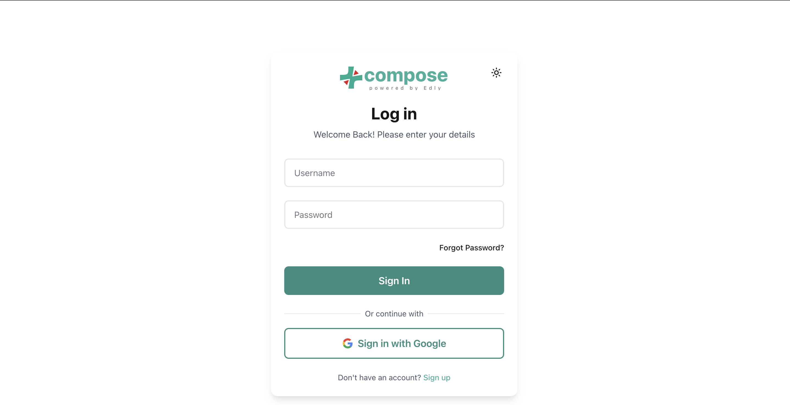

# Signing up and signing in

!!! note "Before you sign up"
    Your administrator decides who can create an account. Sign-up may be turned off, and only
    emails or domains on the administrator's whitelist can register. If the whitelist is empty,
    nobody can sign up. If you cannot register, ask your administrator for an account.

## Create an account

1. On the Sparkth home page, click **Get Started**.
2. Fill in **Full name**, your username, your email, a password, and **Confirm password**.
3. Submit the form. Sparkth shows "Check your email" and sends you a confirmation link.
4. Open the email and click the link.

## Confirm your email

The link opens a page that says "Email confirmed". You can now sign in.

If the link has expired, the page asks for your email instead. Enter it and click
**Send new link**. If you see "Please wait before resending", wait a minute and try again.

## Sign in

Sign in with your username and password (your username, not your email) and click **Sign In**.

You can also click **Sign in with Google** under "Or continue with":

- If your Google email matches an existing Sparkth account, you are signed in to that account.
- Otherwise a new account is created for you, as long as your email is on the whitelist.

If you have not confirmed your email yet, signing in shows a reminder with a
**Resend confirmation email** button.

## Forgot your password

1. On the sign-in page, click **Forgot Password?**.
2. Enter the email for your account and click **Send reset link**.
3. Open the email and click **Reset my password**. The link works once, and expires after an
   hour unless your administrator set a different time.
4. Enter your new password twice and click **Reset password**, then sign in with it.

Resetting your password also confirms your email, since the link proves the inbox is yours.

If you sign in with Google SSO, your account has no Sparkth password, so no email is sent.
Sign in with Google instead.

## Your profile

Open the menu with your name at the bottom of the sidebar and click **Profile**. The page shows
your username, email, whether your email is confirmed, and how you sign in.

- **Name**: edit it and click **Save**. It can be up to 30 characters. Your username and email
  cannot be changed here.
- **Password**: enter your current password, then your new one twice, and click
  **Change password**. The new password needs at least 8 characters, with an uppercase letter,
  a number and a special character.

If you sign in via Google SSO, your account has no Sparkth password, so the page shows a note
instead of the password form.

## Common messages

| Message | What it means |
|---|---|
| "Registration is currently disabled" | The sign-up form is turned off. Ask your administrator for an account, or try **Sign in with Google** if your email is on the whitelist. |
| "This email address is not authorized to register. Contact an administrator." | Your email is not on the whitelist. |
| "Your email is not authorized to register. Contact an administrator." | The same, when you signed in with Google. |
| "Please confirm your email before logging in." | Click the link in your confirmation email, or resend it. |
| "A reset link was just sent. Please wait a minute before asking again." | You asked for a reset link moments ago. Check your inbox (and spam folder), or wait a minute. |
| "This password reset link has expired. Request a new one." | Click **Request a new link** and use the newest email. |
| "This password reset link is invalid or has already been used." | The link was used already, or a newer one replaced it. Request a new link. |
