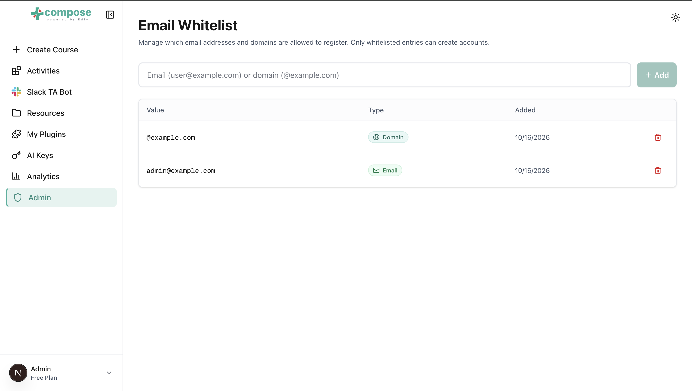

# For administrators

!!! warning "Nobody can sign up until you add an entry"
    The whitelist starts empty, and an empty whitelist blocks every sign-up, by password or
    through a sign-in provider. Add your users' emails or your organisation's domain before you invite anyone.

## Manage the whitelist

The **Admin** entry in the sidebar opens **Email Whitelist**, which decides who may create an
account.

1. Enter an email (`user@example.com`) to allow one person, or a domain (`@example.com`) to
   allow everyone with an address there.
2. Click **Add**.

The table lists each entry with its value, its type (email or domain) and when it was added.
To remove one, click its trash icon and confirm. Removing an entry stops new sign-ups from it;
existing accounts keep working.

Someone who is not on the whitelist sees one of the messages in
[Signing up and signing in](account.md#common-messages).

## Review the audit log

**Audit log** in the sidebar lists who did what and when: sign-ins, key and plugin changes,
permission changes, AI tool calls and more, most recent first.

1. Narrow the list with the filters: a time range, an actor's user id, a category (`auth`,
   `tool`, `llm_config`, ...), an outcome or a source, then click **Apply**. The time range
   includes the whole of the last minute you pick.
2. Click the arrow at the start of a row to see its full details, including what changed and
   the tool arguments.
3. Click **Load more** at the bottom for older events.
4. Click **Export CSV** or **Export JSON Lines** to download every event that matches the
   filters. Each export is itself recorded in the log.

## Accounts

<!-- TODO: describe role management and permission assignment once they have a screen. -->

Sparkth has no screen for managing other people's accounts yet. Each user can change their own
name and password on their [profile page](account.md#your-profile). To create an account, give
someone admin rights or reset a forgotten password, ask whoever runs your Sparkth server.

## Required permissions

**Admin** opens **Email Whitelist**, which needs the whitelist permissions:

| Permission | Lets you |
|---|---|
| `email.whitelist.read` | See the whitelist. |
| `email.whitelist.create` | Add an entry. |
| `email.whitelist.delete` | Remove an entry. |

The admin role has all three.

**Audit log** needs `audit.read`.
