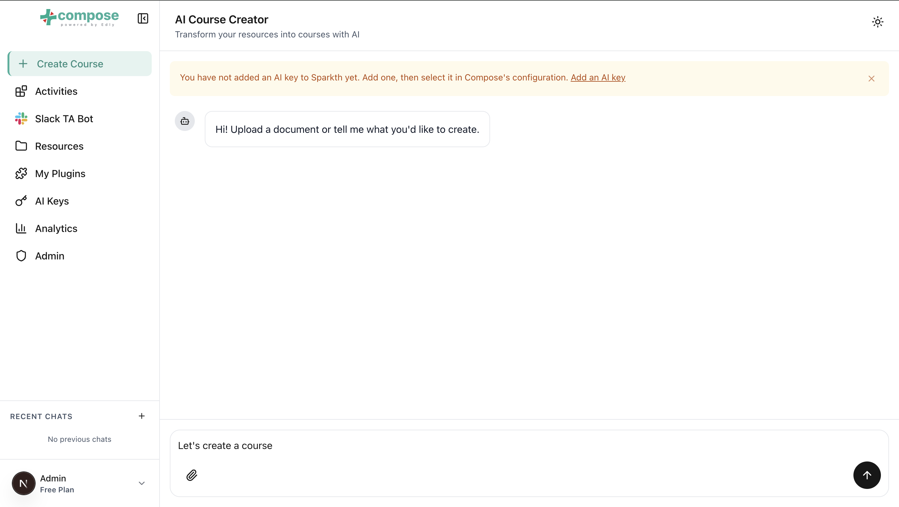

# Create a course

**Compose** is the AI assistant that designs your course with you and builds
it in your LMS.

## Before you start

You need:

- an [AI key](ai-keys.md);
- Compose turned on in [My Plugins](plugins.md), with that key selected in its configuration;
- to build the course in an LMS, that LMS's plugin configured: see
  [Publish to your LMS](publish-to-lms.md).

## If Compose asks for an AI key

If your key isn't set up, sending a message shows a warning at the top of **Compose** that
tells you what is missing:

| Message | What to do |
|---|---|
| "You have not added an AI key to Sparkth yet. Add one, then select it in Compose's configuration." | Click **Add an AI key**. |
| "Select your AI key in Compose's configuration to start creating." | Click **Open plugin settings** and select your key. |

## Ask for a course

1. Open **Compose** from the sidebar.
2. Describe the course in the message box ("Describe the course you want to create...") and
   send it.
3. Answer the assistant's questions. It may offer clickable options; you can always type your
   own answer instead.

Say who the course is for, how long it should be, and which LMS you want it in. The assistant
sticks to course work (designing and building courses, plus anything your other plugins add,
such as interactive activities), and it answers in the language you write in.

## Use your own material

Attaching material is optional: the assistant can design a course from your description alone.
To give it your own documents, open the attach menu next to the message box:

- **Select File** uploads a file from your computer.
- The online drive option (for example **Pick from Google Drive**) uses a file you have
  imported into [Resources](resources.md).

The assistant reads attached files as source material for the course. A file that is still
indexing can't be picked yet. Hover over the dot next to it in the picker: it can be picked once
it reads **Ready**.

## While it works

The assistant shows what it is doing, such as "Reading your attached files…" or
"Writing the answer…". Click **Stop generating** to stop it. When it uses its tools, for
example to create the course in your LMS, the reply shows how many tool calls it made.

## Your conversations

Every conversation is saved, with a title written for you, and listed under **Recent chats**
beside **Compose**. You can collapse the list to a thin strip; on a phone, open it with the
history button at the top of the chat. Open a conversation to pick up where you left off.
