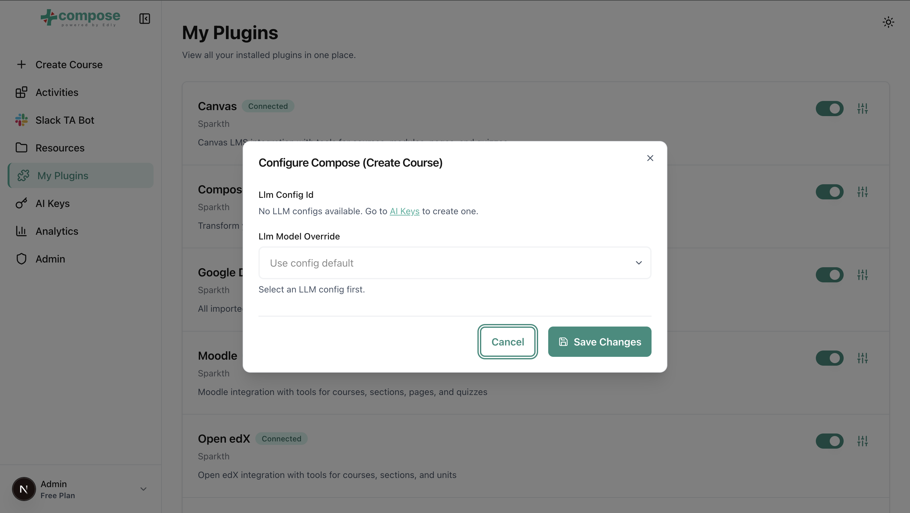

# Settings

A plugin is one feature you can turn on: Compose (the course assistant), an LMS, an online
drive, a team-chat bot, or interactive activities. See
[Supported integrations](index.md#supported-integrations) for which ones Sparkth connects to.
Plugins are per user: turning one on or configuring it affects only your account.

## Turn a plugin on

1. Open **Settings** from the sidebar.
2. Flip the switch next to the plugin.

## Configure a plugin

Most plugins need settings before they do anything, such as an AI key or your LMS address.

1. Turn the plugin on. The sliders button next to the switch stays disabled until you do.
2. Click the sliders button. A "Configure" window opens with the plugin's fields.
3. Fill in the fields and click **Save Changes**.

A saved password or key shows as dots. To change it, click **Replace** and type the new one; leaving it
alone keeps the saved one. Clicked **Replace** by mistake? Click **Keep stored** to go back to the saved one.

!!! warning "Enabled is not configured"
    **Enabled** only means the plugin is turned on. It does not check your credentials or
    your key. Compose, for example, does nothing until you select an AI key in its
    configuration: see [AI keys](ai-keys.md).
