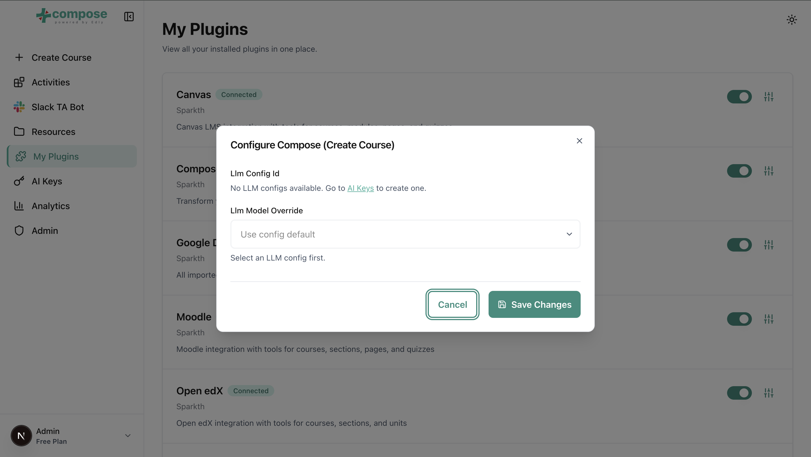

# Settings

A plugin is one feature you can turn on: Compose (the course assistant), an LMS, an online
drive, a team-chat bot, or interactive activities. See
[Supported integrations](index.md#supported-integrations) for which ones Sparkth connects to.
Plugins are per user: turning one on or configuring it affects only your account, unless an
administrator has [switched it off for everyone](#a-plugin-an-administrator-switched-off).

## Turn a plugin on

1. Open **Settings** from the sidebar.
2. Flip the switch next to the plugin.

## Configure a plugin

Most plugins need settings before they do anything, such as an AI key or your LMS address.

1. Turn the plugin on. The sliders button next to the switch stays disabled until you do.
2. Click the sliders button. A "Configure" window opens with the plugin's fields.
3. Fill in the fields and click **Save Changes**.

A saved password or key shows as dots. To change it, click **Replace** and type the new one; leaving it
alone keeps the saved one. Clicked **Replace** by mistake? Click **Keep stored** to go back to the saved one.

A plugin's row shows its saved API key with all but the last few characters hidden, like an AI key. A saved
password is never shown.

## A plugin an administrator switched off

An administrator can switch a plugin off for every user. When they do:

- Its row in **Settings** reads **Switched off by an administrator**. The switch still shows your own
  choice, but you cannot use it, and the sliders button is disabled.
- The plugin leaves the sidebar and the dashboard, and opening its page says an administrator
  switched it off.

Your own choice and your saved settings are kept. When the administrator switches the plugin back on,
it works again as you left it.

!!! warning "Enabled is not configured"
    **Enabled** only means the plugin is turned on. It does not check your credentials or
    your key. Compose, for example, does nothing until you select an AI key in its
    configuration: see [AI keys](ai-keys.md).
